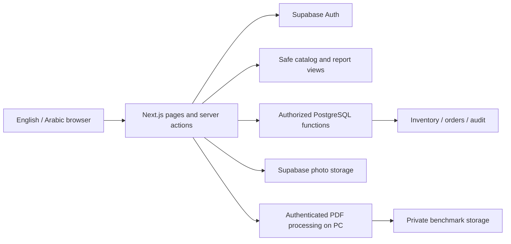

# Architecture

The application is a modular monolith with a separate bounded processing service. Next.js on Vercel owns storefront, seller and admin workflows. Self-hosted Supabase on the PC owns identity, SQL authorization, transactions and storage. FastAPI processes authenticated benchmark PDFs; pricing remains unavailable. Brevo sends Auth email. The active roles are user/admin. See [marketplace architecture](docs/marketplace-architecture.md) for contact privacy, immediate publication and manual evidence review.

## Modules

- `src/app/[locale]`: storefront, catalog, details, accounts, cart and protected operations routes.
- `src/app/actions`: untrusted POST entry points; each mutation validates input and checks a server-verified account and database role.
- `src/lib/auth.ts`: request-scoped authenticated identity and authorization. Layout gating is supplemented by per-page and per-action checks.
- `src/lib/catalog.ts`: server-only projections and catalog queries; failures remain distinguishable from empty datasets.
- `src/lib/validation.ts`, `money.ts`, `domain.ts`: shared strict contracts and integer-piastre amounts.
- `src/lib/uploads.ts`: actual image decoding and metadata removal before storage.
- `src/proxy.ts`: SSR cookie refresh and normalized locale header. Final authorization belongs to actions and PostgreSQL.
- `src/components/ui`: Tailwind/shadcn-compatible primitives with Radix Slot and class variants.
- `supabase/migrations`: the trusted transaction and policy layer.
- `services/api`: versioned Pydantic API contract, health endpoint and protected unavailable pricing response.

## Data and rendering

Catalog and product pages render on the server. Full-text search uses PostgreSQL `simple` tokenization, suitable for indexed Arabic/English token matching; Arabic stemming and typo tolerance are not implemented. Results are bounded to 12 per catalog page with stable ordering. Admin tables show the latest 100 records, and dashboard totals are explicitly scoped to those records.

The cart stores product IDs and quantities in browser storage. Prices are fetched anew and never trusted from storage. Checkout requires authentication; login retains the existing guest cart in the same browser. Cross-device account carts are remaining MVP work.

The locale selector performs document navigation because a shared Next root layout remains mounted during client navigation; this ensures the document's `lang` and `dir` agree with the chosen language. Ordinary navigation within a locale uses Next links.

## Trust boundaries

No service-role key is needed by the Next application. Every query uses the publishable key with the current session. Inventory costs and full serial identifiers are separate from public catalog views. Inspection views omit private notes and user IDs; public inspector references are pseudonymous. Role grants are trusted database operations, never editable user metadata.

PostgreSQL functions use an empty search path, qualified application objects, explicit execute grants and role checks. Monetary and stock changes happen atomically inside those functions. The analysis service uses a private bearer token and is not called from browser code.

## Future growth

The owner-requested marketplace journeys, user/admin roles, signed-in-only seller contact pages and private benchmark PDF review are described in [the marketplace architecture proposal](docs/marketplace-architecture.md). That document distinguishes the proposed schema/workflows from the current implementation; the Complete PCs entry and explicit email-confirmation result page are already implemented.

Introduce seller ownership and moderation before marketplace writes. Add shipping-zone configuration before courier checkout. Add observation provenance and confirmed-sale distinctions before statistical pricing. Introduce a structured hardware specifications catalog before compatibility recommendations. Add queues only when email, inspection and settlement work require durable asynchronous processing.
