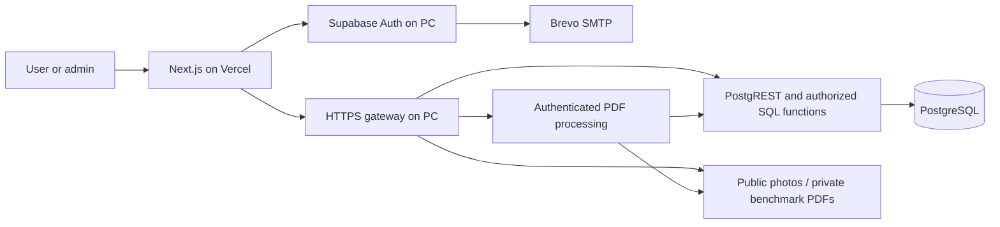

# Marketplace architecture — 16 October 2026

Implemented locally; deployment and acceptance evidence is recorded in `PROJECT_PROGRESS.md`. These owner-selected rules supersede conflicting proposals in the original brief.

## Accounts and contacts

The active role model is exactly **user / admin**. Every regular account can buy and sell. Only trusted operations assign admin; legacy inspectors are not automatically promoted. SQL functions and Next.js guards enforce the same model.

Registration requires email confirmation. A successful email link opens **Account verified**; merely visiting that page cannot verify an account. Resend and password recovery use SMTP. Confirmation proves inbox access, not human identity; CAPTCHA remains unconfigured.

Contact setup requires display name, governorate, and at least one Egyptian mobile number or supported HTTPS social link. Sellers must complete setup before saving listings. Phone-format validation does not prove number ownership.

**Buy / Contact seller** opens an authenticated page. The SQL function discloses contact details for a published, visible listing only, with a 60-view hourly limit per account. Raw contacts are owner-readable. Public HTML and catalog projections contain no contact details. Opening contacts creates no order, stock reservation or payment; buyers arrange transactions directly with sellers.

## Listings, complete PCs and laptops

Sellers submit product details, condition, known defects, asking price, location and a photo for admin review. Every new listing remains private until a confirmed admin approves its current revision. Sellers can save drafts, edit, pause, archive or mark sold. SQL enforces ownership and stale-edit checks. Prices use integer piastres. The web action normalizes photos, stored under immutable owner paths.

Listing approval is independent of benchmark evidence and physical inspection. The **Listing reviews** queue searches permanent PCX references or UUIDs, filters decisions and paginates applications. Admins can approve, request changes or refuse; non-approval requires an explanation. Sellers see the decision, reason and review history in their listing workspace and can edit and resubmit. Substantial content changes invalidate approval; price-only and availability-only changes preserve it. An amended paused listing stays private until the seller resumes/submits it for review. Neither benchmark approval nor an inspection can publish a listing. Previously public listings are returned to pending review during migration; existing paused/draft availability is preserved and no historical approval is invented.

**My listings** and the individual listing workspace expose **Mark as sold**, **Pause listing / Resume listing**, **Relist product** and a confirmed **Delete listing** control. Seller pauses use `status='paused'`; the admin's independent `hidden` flag remains authoritative. Sold, paused and deleted listings leave the public catalog and cannot expose contacts or benchmark PDFs to other users. Resuming/relisting requires current photos and completed contact setup. Availability-only changes preserve the PCX reference, hardware revision and existing review validity; active physical-inspection appointments are cancelled when the listing becomes unavailable and must be requested again.

Recoverable seller deletion sets `deleted_at` and `seller_deleted`, moves the item to the seller's **Deleted** view and retains evidence/history. **Restore as draft** restores only the owner's own deletion and never publishes automatically or clears an admin restriction. Admin-deleted items require an admin to restore. The confirmed-owner `seller_listing_action` RPC locks the listing, checks the expected update timestamp and records each operation in the audit log. Client-side visibility alone grants no permissions.

Sellers can also **permanently delete their own listings**, including paused or previously deleted ones. The separate danger section requires typing the exact PCX reference and checking an irreversible-deletion confirmation. `seller_delete_listing` verifies confirmed ownership and a current update timestamp; it cannot remove another user's listing or company stock. Both owner/admin entry points call one private deletion implementation, which preserves an audit record, removes dependent evidence/requests/reports and queues unshared files. Cleanup entries record the deleting user: sellers can inspect/remove only their queued files, with a retry control in My listings; admins can finish any pending cleanup. Raw queue tables remain inaccessible. The private implementation cannot be called directly by authenticated clients.

**Complete PCs** (`pc-builds`) requires CPU, motherboard, RAM, storage, PSU, case, cooling, graphics (including explicitly integrated graphics), boot status and included accessories. Both server and SQL enforce the fields. Seller specifications are not a compatibility guarantee.

**Laptops** (`laptops`) is available from the homepage, catalog filters, seller form and company inventory category selector in both languages. Seller listings require CPU, graphics, RAM, storage, display, battery condition, charger, keyboard layout, boot status and included accessories. Shared field definitions drive server validation and the seller form; `20261015120000_laptops.sql` enforces the same disclosures in PostgreSQL. Condition details can explicitly say unknown, not tested, missing or faulty; the site does not infer battery health. Fields remain seller-reported and edits invalidate benchmark approval through the existing revision mechanism. Company inventory retains its existing administrator-managed specification editor. The category starts empty until real inventory is added.

The benchmark reference library contains measured desktop systems; adding the laptop sales category does not turn those measurements into laptop performance estimates. Laptop-specific reference results, structured battery reports, saved listings and user reporting remain separate possible enhancements.

## Optional benchmark review

1. Admin approval of the listing permits publication without a benchmark watermark. Evidence can be submitted before publication.
2. Seller optionally uploads benchmark screenshots as an unlocked PDF: at most 12 pages and 3 MB. Include hardware identity, test settings, date and the displayed listing code.
3. The PC service authenticates the owner and rebuilds pages as an image-only PDF in a resource-limited subprocess. The original is discarded. The processed PDF is also capped at 3 MB. Invalid, encrypted or excessive files fail.
4. Any signed-in user can view evidence for the current hardware revision of a published, visible listing, including before approval. Private storage, row policies and an authenticated no-store download route prevent anonymous access.
5. Admins open or preview the PDF, then choose **Approve — award Benchmark reviewed** or **Refuse — no watermark**, and submit the review. Refusal requires a comment of at least five characters, enforced in the browser, server action and SQL; approval comments are optional. The seller sees the decision and comment in their listing's benchmark history. Comments are also visible to signed-in users who can access that evidence. Historical changes-requested decisions remain supported. Self-approval and reviewing superseded submissions are forbidden, with a specific explanation shown in the admin queue. Current evidence can be reviewed while a listing awaits publication, is paused or is a draft; this does not publish the product.
6. Only approval of the latest evidence for the current hardware revision adds **Benchmark reviewed**. Approval lasts 90 days. Changing hardware details, description, condition, defects or photos invalidates the badge; price-only changes preserve it. New evidence requires fresh review.

The badge means submitted evidence was reviewed; it is not a physical inspection, ownership/authenticity guarantee or warranty. Company inspection reports stay separate. Older evidence remains available to its seller and admins; buyers see current-revision evidence. Review and moderation are audited. Admins can revoke approval; a revoked submission cannot be reapproved without fresh evidence.

## Product management and references

Every seller listing and company product receives a permanent `PCX-100001`-style reference from one database sequence, in addition to its UUID. References appear on product cards, detail pages and seller management. `/[locale]/admin/products` searches references, UUIDs, titles, brands/models and company SKUs across all states, with 25 results per page. Filters distinguish source, publication state, paused/deleted products and active inspection requests.

Admins can edit listings, pause/resume publication, delete recoverably, restore to a paused draft, remove either kind of watermark and view an audit trail. Mutations require confirmed admin authorization in SQL and a server-side admin guard; stale timestamps prevent overwriting another admin's change. Recoverable deletion preserves order, inventory, evidence and review history. A deleted listing cannot be edited or revived through the legacy hide/restore endpoint. Sellers can edit paused listings but cannot remove the admin pause. Admin-paused products have an explicit Resume button. Resuming a seller listing checks seller contact setup, uploaded photos and current listing approval; an unapproved publication request returns to the review queue. Seller-paused, sold and archived listings retain their publication state when an admin restriction is cleared. Company pauses also block new checkout, while existing reserved orders remain intact.

Admins also have a separate **Permanently delete product** section. They must type the exact permanent product reference, enter a reason and confirm irreversibility. SQL validates admin privileges, the reference and stale timestamps. Seller removal deletes its benchmark submissions, inspection requests/reports, private device identity and contact-access records. Unused company stock can be removed, but any company product referenced by an order is protected; use recoverable deletion for those products. The admin audit record and product reference remain recorded, and references are never reused.

Deletion transactionally queues associated PDF/photo files for removal through the authenticated Storage API. Photos still referenced by another product, report or benchmark snapshot are preserved. A private file ledger prevents deleted-path reuse and records cleanup completion only after the storage object is gone. Interrupted cleanup can be retried from All products. No privileged Supabase key is sent to Vercel.

Watermarks are computed from evidence records, never arbitrary image decorations. Benchmark approval uses the PDF review workflow. Physical inspection approval uses the report flow below. Both can be revoked; admin access to historical reports remains available for paused/deleted products.

The admin navigation has three independent application queues: **Listing reviews** for publication requests, **Benchmark reviews** for submitted benchmark PDFs and **Inspections** for physical-inspection requests. Each shows the applicant and permanent product reference, accepts a `PCX-…` reference or UUID, filters by application status and paginates 20 applications at a time. Products without a corresponding application never appear in that queue. Confirmed-admin SQL functions perform filtering and enforce access to applicant details.

The product workspace is the common management entry point. Its two review links open the appropriate queue filtered to that product ID, including previous applications. PDF decisions are made in Benchmark reviews; scheduling and physical reports are managed in Inspections. Company-stock reports are created from the individual company product workspace and do not appear as seller inspection applications.

## Free physical inspections

Published seller listings can request an on-ground inspection. **The launch fee is EGP 0**, enforced in SQL; there is no payment step. Requests include private area/availability notes. Admins use the single **Inspections** queue, consult seller contact information, and schedule, reschedule, decline or cancel. Scheduled requests expose the physical-report form in that same queue; completed requests link to their report. Sellers can cancel their own active requests. One active request per listing and a daily limit prevent duplicate requests. Hardware changes or withdrawal automatically cancel active requests.

Only a confirmed admin can publish a report for a scheduled, current listing. Self-inspection of the admin's own marketplace listing is forbidden. The report requires a visit attestation, date, private full serial/device identifier, public identifying description, visit photos, findings, defects, and observed results for every category-specific check. Passing requires all checks to pass. Failed or incomplete reports remain evidence without granting a watermark. Photos are normalized through the existing image upload path; the full identifier is stored in a private schema and never appears in a public projection. Admins must mask serial numbers, addresses and faces in public photo evidence.

The latest passing report awards **PCX Inspected** for the same hardware revision until 90 days after the visit date (Cairo), unless revoked. Buyers open the public dated report from the listing; evidence cannot establish a warranty or guarantee future condition. Admin claims require an actual visit; software cannot independently prove attendance. Inspection availability and service areas are confirmed manually; requesting does not guarantee a visit.

## Data and deployment

| Entity                  | Boundary                                                      |
| ----------------------- | ------------------------------------------------------------- |
| `account_roles`         | One user/admin role; no self-promotion.                       |
| `profile_contacts`      | Owner reads; authorized RPC reveals selected fields.          |
| `marketplace_listings`  | Ownership, publication state, price, hardware and revision.   |
| `benchmark_submissions` | Immutable evidence snapshot and review decision/date/expiry.  |
| `marketplace_catalog`   | Public projection with computed badge; no contacts/PDF paths. |
| `all_catalog_products`  | Combined catalog with explicit company/seller source.         |
| `audit_logs`            | Review, moderation and administrator-assignment records.      |

Marketplace listings never enter company inventory or checkout. SQL checkout rejects marketplace IDs. Company checkout remains separate.

Vercel receives public connection settings only. The privileged service key stays on the PC for evidence storage/commit and is excluded from the renderer subprocess. The gateway exposes only the authenticated evidence endpoint from Python. PDF rewriting is not a malware-scanner claim.

## Operational limits

The PC, Docker and HTTPS tunnel must stay online. A changed tunnel address requires frontend configuration and redeployment. A changed home IP may require Brevo authorization. Use stable backend and sender domains before launch. The site retains its development-preview notice.

Separate future work: user-to-user payments, ratings, disputes, phone verification, CAPTCHA, backups/restore acceptance, user-submitted abuse reports, abandoned-photo cleanup and account deletion. Company stock retains its existing inspection form; the stricter visit/checklist flow introduced here covers seller inspections.
